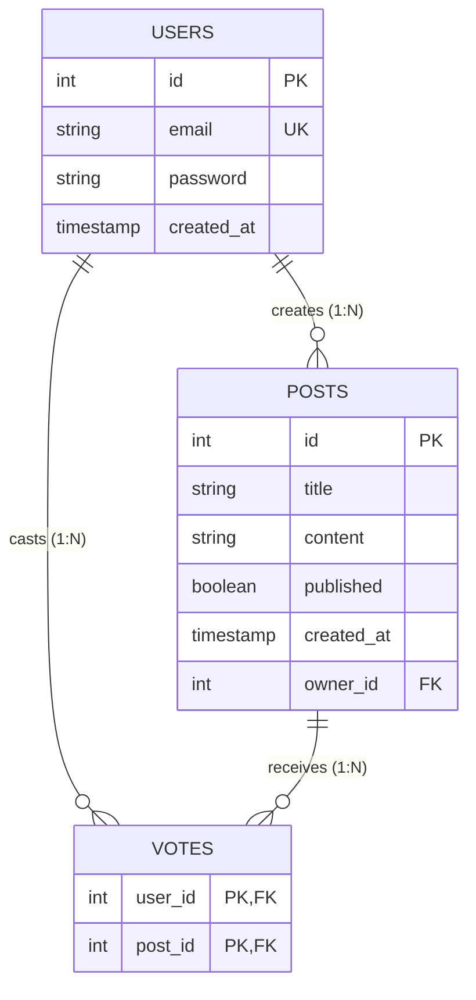

# FastAPI Social Media & Voting API

A production-ready, feature-complete RESTful API built with **FastAPI**, **PostgreSQL**, and **SQLAlchemy**. The application implements a social media / forum-style platform featuring user authentication, post management with ownership enforcement, and an upvote/unvote system with real-time vote count aggregation.

---

## Features

- **User Management & Authentication**:
  - Secure registration and user profile queries.
  - Password hashing with Bcrypt (`passlib`).
  - OAuth2 Password Bearer flow issuing signed JWT access tokens (`python-jose`).
- **Post Management (CRUD)**:
  - Create, read, update, and delete posts.
  - Strict ownership-based authorization (users can only edit/delete their own posts).
  - Search filtering (`search` query param on post title) and pagination (`limit`, `skip`).
  - SQL aggregation: Posts query joins the votes table (`LEFT OUTER JOIN`) to calculate total vote count per post.
- **Vote / Like System**:
  - Upvote or remove a vote on any post (`dir=1` or `dir=0`).
  - Enforced single vote per user per post (returns `409 Conflict` on duplicate vote).
  - Cascade deletion on post or user removal.
- **Database Migrations**:
  - Managed via **Alembic** for tracked schema evolution.
- **Automated Testing Suite**:
  - Comprehensive unit and integration test suite using **Pytest**.
  - Isolated test database lifecycle fixtures with FastAPI `dependency_overrides`.
- **DevOps & Production Ready**:
  - Dockerized development and production setups via `docker-compose`.
  - CI/CD workflow with **GitHub Actions** (automated testing and continuous deployment).
  - Production configurations included for **Gunicorn** (systemd service) and **Nginx** (reverse proxy).

---

## Tech Stack

- **Framework**: [FastAPI](https://fastapi.tiangolo.com/) (Python 3.9+)
- **Database**: [PostgreSQL](https://www.postgresql.org/)
- **ORM & Migrations**: [SQLAlchemy](https://www.sqlalchemy.org/) & [Alembic](https://alembic.sqlalchemy.org/)
- **Data Validation & Settings**: [Pydantic](https://docs.pydantic.dev/)
- **Authentication**: JWT (JSON Web Tokens) via `python-jose`, passwords via `passlib[bcrypt]`
- **Testing**: [Pytest](https://docs.pytest.org/), `httpx` / `requests` TestClient
- **Server & Deployment**: Uvicorn, Gunicorn, Nginx, Docker & Docker Compose, GitHub Actions

---

## Project Structure

```
├── .github/workflows/
│   └── build-deploy.yml         # CI/CD: Automated testing & deployment
├── alembic/                     # Database migration scripts
│   ├── env.py                   # Alembic runtime environment
│   └── versions/                # Migration revisions
├── app/                         # Application source code
│   ├── routers/
│   │   ├── auth.py              # Login & JWT token issuance
│   │   ├── post.py              # Post CRUD & vote count aggregation
│   │   ├── user.py              # User registration & lookup
│   │   └── vote.py              # Voting endpoints
│   ├── calculations.py          # Unit test demonstration module
│   ├── config.py                # Environment configuration (Pydantic BaseSettings)
│   ├── database.py              # SQLAlchemy engine, session maker, & get_db dependency
│   ├── main.py                  # FastAPI initialization & CORS middleware
│   ├── models.py                # Database models (User, Post, Vote)
│   ├── oauth2.py                # JWT authentication dependencies & token handling
│   ├── schemas.py               # Pydantic validation & response schemas
│   └── utils.py                 # Password hashing utilities
├── tests/                       # Pytest test suite
│   ├── conftest.py              # Test database fixtures, client, & auth helpers
│   ├── test_calculations.py     # Unit tests for calculations logic
│   ├── test_posts.py            # Integration tests for post endpoints
│   ├── test_users.py            # Integration tests for user endpoints & authentication
│   └── test_votes.py            # Integration tests for vote endpoints
├── Dockerfile                   # Docker container specification
├── docker-compose-dev.yml       # Local development multi-container orchestration
├── docker-compose-prod.yml      # Production multi-container orchestration
├── gunicorn.service             # Systemd service file for Linux VPS
├── nginx                        # Nginx reverse proxy configuration
├── Procfile                     # Process file for Heroku deployment
├── alembic.ini                  # Alembic CLI settings
├── requirements.txt             # Project dependencies
└── README.md
```

---

## Database Architecture

The relational schema consists of three interconnected models:



- **Users (`users`)**: Primary key `id`, unique `email`, hashed `password`, and creation timestamp.
- **Posts (`posts`)**: Primary key `id`, `title`, `content`, `published` flag, and `owner_id` (foreign key to `users.id` with `CASCADE` delete).
- **Votes (`votes`)**: Composite primary key on `(user_id, post_id)` linking back to `users` and `posts` with `CASCADE` delete.

---

## API Endpoints Reference

Once running, interactive API documentation is available at:

- **Swagger UI**: `http://127.0.0.1:8000/docs`
- **ReDoc**: `http://127.0.0.1:8000/redoc`

### 1. Authentication

| Method | Endpoint | Description                               | Auth Required | Request Body / Form                                  |
| ------ | -------- | ----------------------------------------- | ------------- | ---------------------------------------------------- |
| `POST` | `/login` | Authenticate user & retrieve access token | No            | `OAuth2PasswordRequestForm` (`username`, `password`) |

### 2. Users

| Method | Endpoint      | Description            | Auth Required | Response Model            |
| ------ | ------------- | ---------------------- | ------------- | ------------------------- |
| `POST` | `/users/`     | Register a new user    | No            | `201 Created` (`UserOut`) |
| `GET`  | `/users/{id}` | Get user details by ID | No            | `200 OK` (`UserOut`)      |

### 3. Posts

| Method   | Endpoint      | Description                             | Auth Required        | Query Parameters / Body                                                              |
| -------- | ------------- | --------------------------------------- | -------------------- | ------------------------------------------------------------------------------------ |
| `GET`    | `/posts/`     | Get list of posts with vote counts      | Yes (`Bearer Token`) | `limit` (int, default 10)<br>`skip` (int, default 0)<br>`search` (str, title search) |
| `POST`   | `/posts/`     | Create a new post                       | Yes (`Bearer Token`) | `{"title": str, "content": str, "published": bool}`                                  |
| `GET`    | `/posts/{id}` | Get single post details with vote count | Yes (`Bearer Token`) | None                                                                                 |
| `PUT`    | `/posts/{id}` | Update existing post (Owner only)       | Yes (`Bearer Token`) | `{"title": str, "content": str, "published": bool}`                                  |
| `DELETE` | `/posts/{id}` | Delete post (Owner only)                | Yes (`Bearer Token`) | None (`204 No Content`)                                                              |

### 4. Votes

| Method | Endpoint | Description             | Auth Required        | Request Body                                                                   |
| ------ | -------- | ----------------------- | -------------------- | ------------------------------------------------------------------------------ |
| `POST` | `/vote/` | Upvote or remove a vote | Yes (`Bearer Token`) | `{"post_id": int, "dir": 1}` to vote<br>`{"post_id": int, "dir": 0}` to unvote |

---

## Environment Variables

Create a `.env` file in the root directory and define the following variables:

```env
DATABASE_HOSTNAME=localhost
DATABASE_PORT=5432
DATABASE_PASSWORD=your_postgres_password
DATABASE_NAME=fastapi
DATABASE_USERNAME=postgres
SECRET_KEY=your_openssl_generated_secret_key
ALGORITHM=HS256
ACCESS_TOKEN_EXPIRE_MINUTES=60
```

> **Tip:** You can generate a secure `SECRET_KEY` using:
>
> ```bash
> openssl rand -hex 32
> ```

---

## Getting Started (Local Setup)

### 1. Clone the repository

```bash
git clone https://github.com/leyroy/FastAPI-social-media-API.git
cd fastapi-course
```

### 2. Create and activate a virtual environment

- **On Linux / macOS:**
  ```bash
  python3 -m venv .venv
  source .venv/bin/activate
  ```
- **On Windows:**
  ```powershell
  python -m venv .venv
  .venv\Scripts\activate
  ```

### 3. Install dependencies

```bash
pip install -r requirements.txt
```

### 4. Set up PostgreSQL Database

Ensure you have a PostgreSQL server running and create the database specified in `.env`:

```sql
CREATE DATABASE fastapi;
CREATE DATABASE fastapi_test; -- Needed for running tests
```

### 5. Apply Database Migrations

Run Alembic to create all database tables:

```bash
alembic upgrade head
```

### 6. Run the Application

Start the Uvicorn development server with hot-reload enabled:

```bash
uvicorn app.main:app --reload
```

The application will be live at `http://127.0.0.1:8000`.

---

## Running with Docker

### Development Mode

Spins up both the PostgreSQL 16 database and the FastAPI application with live hot-reloading:

```bash
docker-compose -f docker-compose-dev.yml up --build
```

- API accessible at `http://localhost:8000`
- PostgreSQL accessible at `localhost:5433`

### Production Mode

```bash
docker-compose -f docker-compose-prod.yml up -d
```

---

## Running Tests

The test suite runs against the dedicated test database (`<DATABASE_NAME>_test`).

Run all tests with Pytest:

```bash
pytest -v -s
```

To run a specific test module:

```bash
pytest tests/test_posts.py -v -s
```

---

## Deployment & Production Architecture

- **Gunicorn + Uvicorn Workers**:
  [`gunicorn.service`](./gunicorn.service) runs 4 Uvicorn workers managed by systemd:
  ```bash
  gunicorn -w 4 -k uvicorn.workers.UvicornWorker app.main:app --bind 0.0.0.0:8000
  ```
- **Nginx Reverse Proxy**:
  [`nginx`](./nginx) proxies external port 80 HTTP traffic to `http://localhost:8000` handling headers and websocket upgrades.
- **CI/CD with GitHub Actions**:
  [`.github/workflows/build-deploy.yml`](./.github/workflows/build-deploy.yml) automatically runs the test suite inside an ephemeral PostgreSQL container on pushes and pull requests, followed by deployment to Heroku or SSH-based deployment to an Ubuntu server.

---

## Deployment & Production Architecture

- **Gunicorn + Uvicorn Workers**:
  [`gunicorn.service`](./gunicorn.service) runs 4 Uvicorn workers managed by systemd:
  ```bash
  gunicorn -w 4 -k uvicorn.workers.UvicornWorker app.main:app --bind 0.0.0.0:8000
  ```
- **Nginx Reverse Proxy**:
  [`nginx`](./nginx) proxies external port 80 HTTP traffic to `http://localhost:8000` handling headers and websocket upgrades.
- **CI/CD with GitHub Actions**:
  [`.github/workflows/build-deploy.yml`](./.github/workflows/build-deploy.yml) automatically runs the test suite inside an ephemeral PostgreSQL container on pushes and pull requests, followed by deployment to Heroku or SSH-based deployment to an Ubuntu server.
